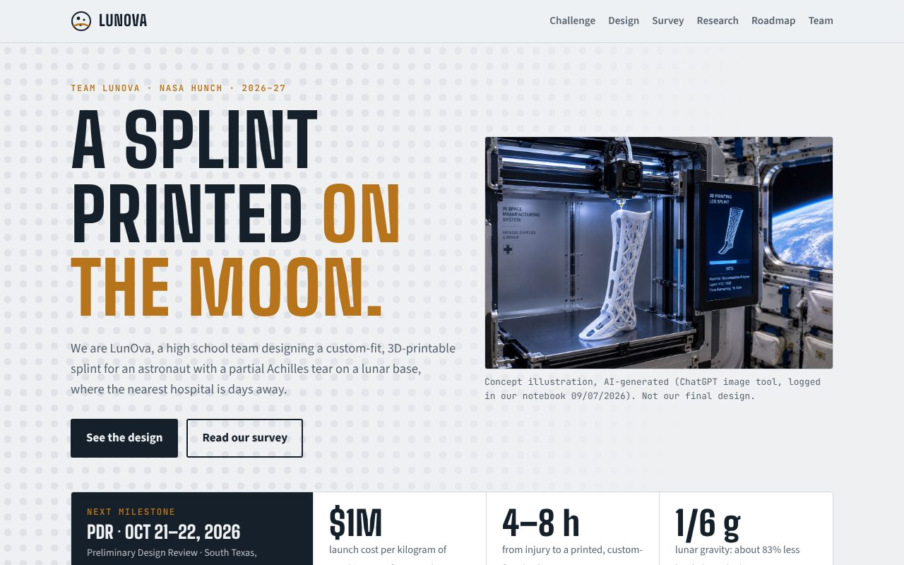

# Lunova · Lunar Splint Project

**Live site: https://gertrudish978-pixel.github.io/lunar-splint/**

[](https://gertrudish978-pixel.github.io/lunar-splint/)

Website for Lunova, a NASA HUNCH 2026–27 team taking on the Lunar Splint Design Challenge: OrthoPrint, a custom-fit, 3D-printable splint for a lateral ankle ligament tear on a lunar base.

Built with Next.js (App Router) as a static export.

## Run locally

```bash
npm install
npm run dev     # http://localhost:3000
npm run build   # static site in out/
```

## Editing content

Each section is its own page under `app/` (challenge, design, survey, research, roadmap, team). Most text, survey numbers, the spec sheet and deliverable statuses are in `lib/content.ts`. Change a status (`"ok"`, `"wip"`, `"todo"`) there when the team makes a decision. Photos live in `public/images/`.

## Deploying

`.github/workflows/deploy.yml` builds and publishes to GitHub Pages on every push to `main`. In the repo's **Settings → Pages**, set **Source** to **GitHub Actions** once.
